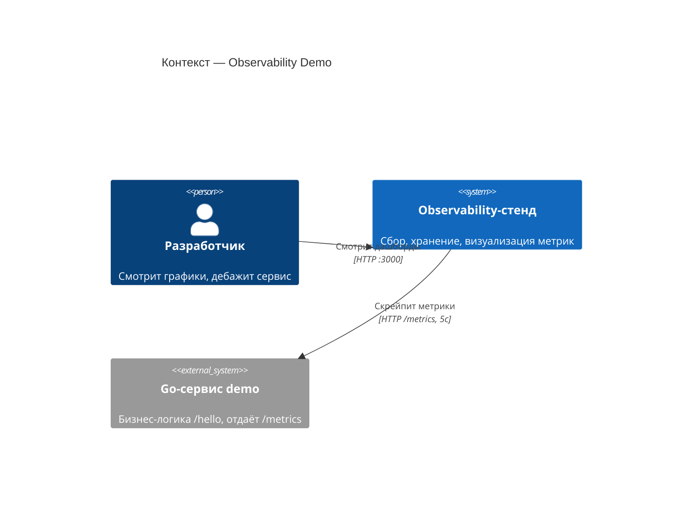

# Go Observability Demo

Минимальный рабочий стенд observability: Go-сервис отдаёт метрику,
**Grafana Alloy** собирает её и отправляет в **Prometheus**, а **Grafana** рисует график.

Один счётчик запросов — и полный путь телеметрии от строчки кода до дашборда.

## Архитектура

```
Go-сервис (:8080/metrics)
        │  scrape каждые 5s
        ▼
   Grafana Alloy (:12345 — UI)
        │  remote_write
        ▼
   Prometheus (:9090)
        ▲
        │  PromQL-запросы
   Grafana (:3000)
```

| Компонент  | Роль                                             | Порт  |
|------------|--------------------------------------------------|-------|
| Go-сервис  | отдаёт метрику `demo_requests_total` на /metrics | 8080  |
| Alloy      | скрейпит метрики и отправляет в Prometheus       | 12345 |
| Prometheus | хранит метрики                                   | 9090  |
| Grafana    | визуализация                                     | 3000  |

## Структура проекта

```
.
├── main.go             # Go-сервис: /hello + /metrics
├── config.alloy        # пайплайн Alloy: scrape → remote_write
├── docker-compose.yml  # Prometheus + Alloy + Grafana
└── README.md
```

## Требования

- Go 1.23+
- Docker + Docker Compose v2
- curl

## Быстрый старт

```bash
git clone https://github.com/andrey-korolev-ms/alloy-demo.git
cd alloy-demo

# 1. Поднять инфраструктуру
docker compose up -d

# 2. Запустить Go-сервис
go mod tidy
go run main.go
```

В отдельном терминале — генератор нагрузки:

```bash
while true; do curl -s localhost:8080/hello > /dev/null; sleep 0.2; done
```

## Куда смотреть

| URL | Что там |
|-----|---------|
| http://localhost:8080/metrics | сырая метрика: `demo_requests_total{path="/hello"} N` |
| http://localhost:12345 | UI Alloy → вкладка **Graph**: пайплайн `scrape → remote_write`, состояние таргета |
| http://localhost:9090 | Prometheus: запрос `demo_requests_total` → вкладка Graph |
| http://localhost:3000 | Grafana (вход анонимный, настроен для локальной лабы) |

**Настройка Grafana (один раз):**
Connections → Data sources → Prometheus → URL `http://prometheus:9090` → Save & test.
Затем Explore → запрос:

```promql
rate(demo_requests_total[1m])
```

Это RPS сервиса (~5 при нагрузке из цикла выше). Останови цикл — график упадёт к нулю.

## Как это работает

Весь пайплайн — два компонента в `config.alloy`:

- `prometheus.scrape "go_app"` — раз в 5 секунд забирает метрики с `host.docker.internal:8080`
- `prometheus.remote_write "prom"` — отправляет их в Prometheus на `/api/v1/write`

Выход первого компонента подключён ко входу второго через `forward_to`.
Приложение ничего не знает о том, куда уходят его метрики, — маршрут целиком в конфиге Alloy.

После правок `config.alloy`:

```bash
docker compose restart alloy
```

## Остановка

```bash
docker compose down
```

## Заметки

- Анонимный Admin в Grafana — только для локального стенда, не для публичного сервера.
- `extra_hosts: host.docker.internal:host-gateway` нужен на Linux; на macOS/Windows работает из коробки.
- Секреты (если появятся токены Grafana Cloud) — только в `.env`, который в `.gitignore`.

## Планы

- [ ] Гистограмма латентности `/hello`
- [ ] Логи сервиса → Loki через Alloy
- [ ] Трейсы через OpenTelemetry SDK → Tempo
- [ ] Метрики PostgreSQL через `prometheus.exporter.postgres`

## Скриншоты

<!-- Раскомментируй, когда добавишь скриншоты в папку docs/


-->
## СХЕМА C4 context


